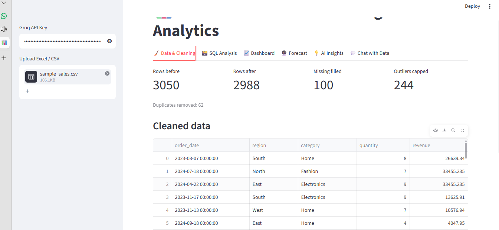
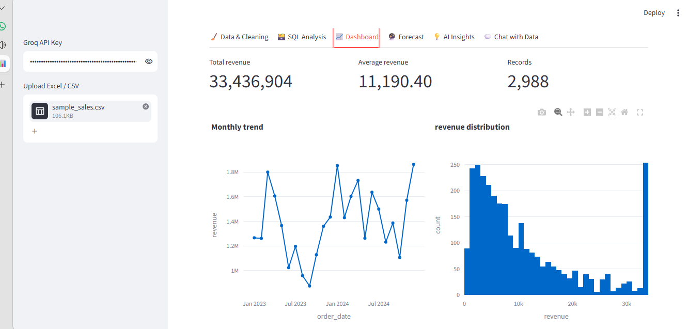
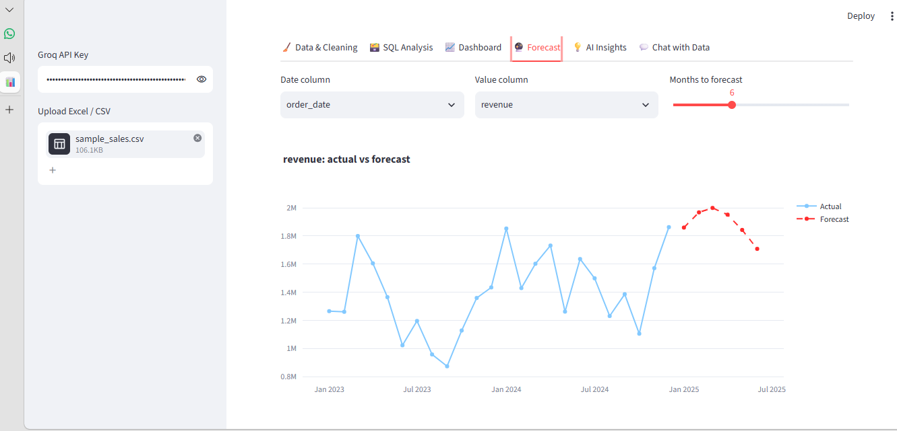
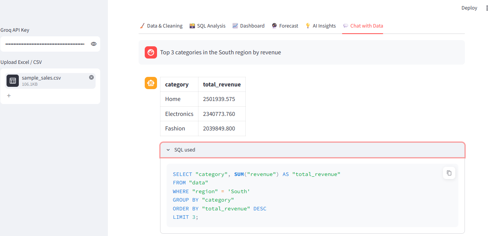

# 📊 AI-Powered Business Intelligence & Data Analytics System

An end-to-end analytics app. Upload a CSV or Excel file, get it cleaned automatically, explore it with SQL, view an interactive dashboard, forecast revenue, generate AI business insights, and ask questions about your data in plain English.

## ✨ Features

- **Upload data:** CSV and Excel (.xlsx/.xls), with automatic encoding and separator detection
- **Auto data cleaning (Pandas):** column name standardization, duplicate removal, date and number parsing, missing value handling, outlier capping (IQR)
- **SQL analysis:** KPI, top-category and monthly-trend queries on in-memory SQLite, plus a custom read-only SQL editor
- **Interactive dashboard:** KPI cards, trend, category and distribution charts (Plotly)
- **Sales and revenue forecasting:** trend + seasonality regression (scikit-learn) with a 3-month backtest (MAE, MAPE)
- **AI business insights:** key findings, risks and recommendations generated with the Groq API
- **Chat with your data:** natural language to SQL to a plain-English answer, with the SQL shown for transparency
- **Power BI ready:** export the cleaned dataset and build the dashboard using the included DAX measures

## 🛠️ Tech Stack

Python · Pandas · NumPy · SQL (SQLite) · scikit-learn · Plotly · Streamlit · Groq API · Power BI

## 🧱 Project Structure

```
├── app.py                 # Streamlit UI (6 tabs)
├── cleaning.py            # Load and auto-clean data
├── sql_analysis.py        # SQL queries and column detection
├── forecasting.py         # Revenue forecasting
├── ai_insights.py         # AI insights and text-to-SQL chat
├── generate_sample_data.py
├── requirements.txt
└── .env.example
```

## 🚀 Getting Started

```bash
git clone https://github.com/YOUR_USERNAME/ai-bi-analytics-system.git
cd ai-bi-analytics-system
python -m venv venv
venv\Scripts\activate          # Mac/Linux: source venv/bin/activate
pip install -r requirements.txt
```

Create a `.env` file (see `.env.example`) and add your key from [console.groq.com](https://console.groq.com):

```
GROQ_API_KEY=your_key_here
```

Optional test data, then run:

```bash
python generate_sample_data.py
streamlit run app.py
```

## 💬 Example Questions for Chat

- Which region has the highest revenue?
- Show monthly revenue for 2024
- Top 3 categories by revenue in the South region

## 📸 Screenshots

| Cleaning | Dashboard |
|---|---|
|  |  |

| Forecast | Chat with Data |
|---|---|
|  |  |

## ⚠️ Notes and Limitations

- Forecasting needs at least 6 months of data (9+ for the backtest).
- Chat generates SQL with an LLM, so check the "SQL used" section for important answers.
- Column roles (date, revenue, category) are auto-detected from column names.

## 🔮 Future Improvements

- Prophet / XGBoost forecasting
- FastAPI backend and Docker deployment
- Support for multiple tables and database connections

## 👩‍💻 Author

**Mandavi Tripathi** · [LinkedIn](https://linkedin.com/in/your-profile) · [GitHub](https://github.com/YOUR_USERNAME)
